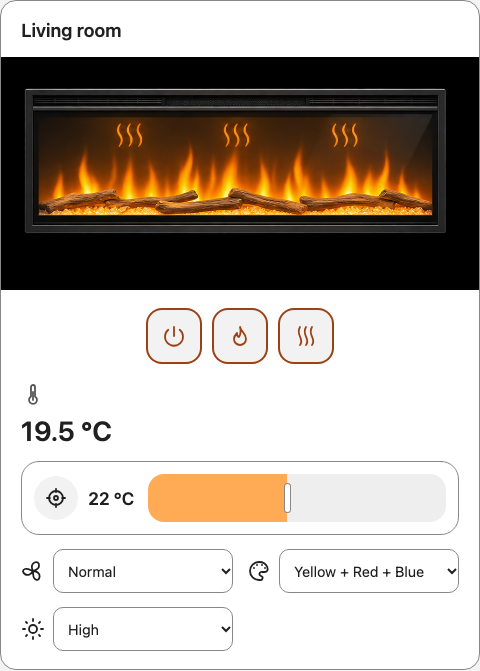

<p align="center"></p>

# Flame Connect Card

An **unofficial Lovelace control panel** designed to work with the [Flame Connect HA integration](https://github.com/smarquina/Flame-Connect-HA). The integration supplies fireplace entities, authentication and cloud communication; this card provides their dashboard interface. Install both projects to use them together.

[](https://github.com/smarquina/flame-connect-card/actions/workflows/validate.yml)
[](https://sonarcloud.io/summary/new_code?id=smarquina_flame-connect-card)

This community project is not affiliated with, approved by, or supported by Glen Dimplex or the fireplace manufacturers. The shared avatar identifies its relationship with Flame Connect HA; it does not imply endorsement.

[](https://my.home-assistant.io/redirect/hacs_repository/?owner=smarquina&repository=flame-connect-card&category=plugin)

## Controls

- Grouped icon buttons for whole-device power, decorative flame and heating/ventilation. The power button offers start when off and power-off when on; it requires a mapped power entity.
- Target-temperature slider with the climate entity's limits, step and unit; one command per completed drag and confirmed numeric readback.
- Normal, Eco and Fan only presets when supported.
- The fireplace's discrete flame color and brightness options.
- An optional external room-temperature sensor, independent from the heating setpoint.
- Whole-device power is shown by default when mapped; set `show_power: false` to hide it.
- Four static fireplace illustrations for effects off, flame only, heating only, and heating with flame.
- Visual configuration with independent visibility settings for power, flame, heating, image, target/room temperatures, mode, color and brightness.
- English/Spanish localization, keyboard controls and responsive layout.

The illustrations use the supplied four-state artwork. They do not animate or reproduce every flame color. Heat symbols indicate **heating enabled**, not measured heat output. Fan only uses a ventilation icon and does not display heat symbols. An unavailable state is never illustrated as a confirmed shutdown.



The card uses icons instead of action labels and explanatory paragraphs. Tooltips identify controls on hover; accessible names support screen readers and keyboard navigation. Temperature values and selected options remain visible. Pending commands and errors use status icons with accessible messages.

## Requirements

- Home Assistant 2026.10.4 or newer, subject to the tested versions documented in release notes.
- [Flame Connect HA](https://github.com/smarquina/Flame-Connect-HA), with the desired fireplace selected and its entities available.
- A current browser supporting ES2022 JavaScript modules and custom elements.

The card needs no separate Flame Connect login, JWT, backend service or cloud API configuration. Installing a dashboard card does not install the backend integration.

## Installation

### HACS / Marketplace

Add `https://github.com/smarquina/flame-connect-card` as a custom **Dashboard** repository (`plugin` internally). Download an available version and refresh the frontend. Enable pre-release versions when installing a beta. This repository is not automatically part of the default catalog.

Once available, add **Flame Connect Card** through the dashboard card picker. Select a detected fireplace or assign its entities manually. Choose an external temperature sensor if desired. Under **Visible elements**, hide any controls or readings you do not want; for example, uncheck **Show target temperature** to retain heating controls without displaying the setpoint. Use **Control order** to reorder room temperature, target temperature, heating/fan mode, color and brightness with the up/down buttons.

If the resource is not registered automatically, add `/hacsfiles/flame-connect-card/flame-connect-card.js` as a **JavaScript module** in the dashboard resource settings. Resource settings may require Advanced Mode in the user profile. See [installation and updates](docs/installation.md).

### Manual installation

Download `flame-connect-card.js` from a published release, place it in `config/www/`, and register `/local/flame-connect-card.js?v=VERSION` as a JavaScript module. Update the version query when replacing the file. Then add the card using the picker or dashboard YAML editor.

## Example configuration

```yaml
type: custom:flame-connect-card
name: Living room
entities:
  flame: light.living_room_flame
  climate: climate.living_room_heating
  color: select.living_room_flame_color
  brightness: select.living_room_flame_brightness
  ambient: sensor.living_room_temperature
```

Entity names above are examples: use your actual entity IDs. At least `flame` or `climate` is required. Other entities are optional. [Configuration reference](docs/configuration.md).

## Behavior and limitations

- Changing the target does not turn heating on. Choosing a preset does not turn heating on or change flame state.
- The external sensor **only displays temperature**. It does not replace the fireplace's thermostat or regulate heating.
- Whole-device power in Flame Connect HA can enable both heating and flame. The card never invokes it implicitly to start a decorative flame. When a configured power entity reports standby, flame-on is disabled until the device is explicitly started.
- Color requires the backend's experimental color option, a supported model and an enabled color entity. The card does not enable entities or invent RGB values.
- Brightness uses the entity's actual options, not an arbitrary percentage.
- Controls follow confirmed entity states. A successful action response alone is not treated as confirmation. Unconfirmed actions time out without automatic replay.
- Each card serializes its commands. Multiple cards reflect Home Assistant updates; backend command serialization remains the integration's responsibility.
- Automated browser tests use a simulator. They do not establish physical compatibility with every fireplace or validate a particular Home Assistant release.

## Technical documentation

- [Installation, updates and removal](docs/installation.md)
- [Configuration and entity mapping](docs/configuration.md)
- [Architecture, state handling and compatibility](docs/technical.md)
- [Troubleshooting](docs/troubleshooting.md)

This frontend project follows applicable integration-quality principles but does not claim official Home Assistant Bronze, Silver or Gold certification. HACS validates it as a dashboard plugin.

## License and support

Code is licensed under [MIT](LICENSE). Artwork attribution is documented in [NOTICE](NOTICE). Report problems in [GitHub Issues](https://github.com/smarquina/flame-connect-card/issues), including card/backend/HA versions, browser and fireplace model. Do not include credentials, tokens or unredacted configuration exports.
